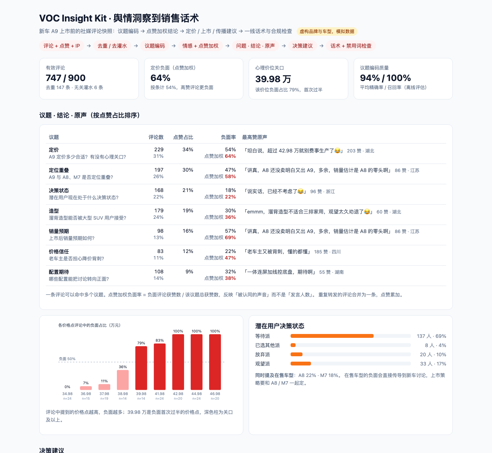
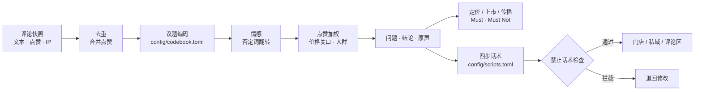
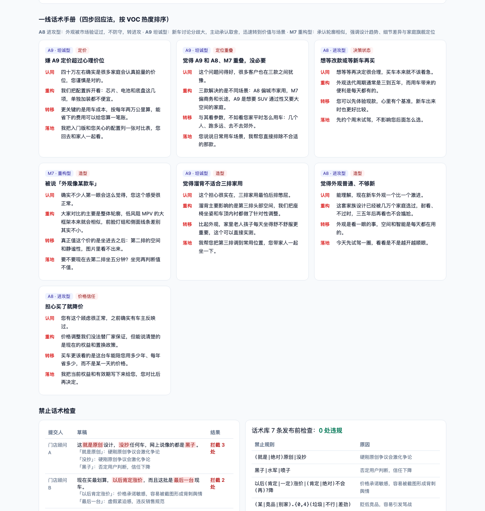

# VOC Insight Kit · 舆情洞察到销售话术

**把社媒评论区的吵吵嚷嚷，变成三样能直接用的东西：给管理层的定价 / 上市 / 传播建议，给门店的四步话术，以及一道拦住「危险话术」的发布前检查。**

[在线报告](https://annawzhang.github.io/voc-insight-kit/) · 纯 Python 标准库，无第三方依赖

> 品牌、车型（A9 / A8 / M7）、评论与点赞全部虚构。



## 解决什么问题

| 痛点 | 做法 |
|---|---|
| 评论几百上千条，读完也说不清「大家到底在吵什么」 | 编码本把评论归到 7 个议题，每个议题输出「问题 · 结论 · 原声」 |
| 按条数统计，会被灌水和复制粘贴带偏 | 去重时合并点赞；负面率同时给出按条计和点赞加权两个口径 |
| 「价格太贵」很笼统，定价决策需要一个数 | 抽取评论里的价格点，找负面占比首次过半的价位，即心理关口 |
| 洞察停在报告里，到不了门店 | 按议题热度排好四步回应话术（认同 → 重构 → 转移 → 落地），按车型分策略 |
| 一线自己编的话术可能引发舆情 | 禁止话术规则检查，命中即拦截并说明原因 |

## 流程



## 关键结论（模拟数据）

| 发现 | 数据 |
|---|---|
| 定价是最受认同的议题 | 点赞占比 34%，点赞加权负面率 64%（按条计 54%） |
| 心理关口在 40 万 | 38.98 万负面占比 36%，39.98 万跳到 79% |
| 在售车型拖累新车 | 22% 评论同时提到 A8，「A8 还没卖明白又出 A9」是高赞原声 |
| 配置是最容易转正的话题 | 配置期待议题近一半是中性提问（「电池是不是大一号」），上市前释放信息就能直接回应 |



## 话术规则

- 每条话术必须正好四步，车型必须在配置里声明了策略（进攻型 / 坦诚型 / 重构型），否则加载时报错。
- 禁止规则覆盖：硬刚原创争议、否定用户（「黑子」「水军」）、价格承诺（「以后肯定涨价」「绝对不会再降」）、贬低竞品、虚假紧迫感。
- 话术库本身在生成报告时也会过一遍检查，有违规会在终端打印出来。

## 快速开始

```bash
python3 run.py                         # 生成 docs/index.html 与 docs/coded_comments.csv
python3 -m unittest discover -s tests  # 9 个测试
```

| 文件 | 作用 |
|---|---|
| `config/codebook.toml` | 议题关键词、情感词、否定词、人群规则 |
| `config/scripts.toml` | 车型策略、四步话术、禁止规则、演示用草稿 |
| `voc/synth.py` | 生成虚构评论（含真实议题标签，用于离线评估） |
| `voc/analyze.py` | 去重、编码、情感、点赞加权、价格关口、人群、共现 |
| `voc/scripts.py` | 话术加载与禁止话术检查 |
| `voc/report.py` | HTML 报告 |

## 设计取舍

- **关键词编码而非大模型分类**：运营能直接读懂和修改编码本，结果可复现；代价是精确率，「决策状态」会被顺带提到的词误命中，报告里如实列出了各议题的精确率和召回率。
- **点赞加权**：发言人数代表「有多少人在说」，点赞代表「有多少人认同」。定价议题两个口径差了 10 个百分点，说明高赞评论更负面。
- **关口用「首次过半」**：比拟合曲线更容易向业务解释，也更不容易被少数极端评论左右（要求该价格点至少 8 条评论）。
- **话术不承诺价格**：价格信任议题里，任何「不会再降」的承诺都可能在降价后被截图，禁止规则里专门拦了这一类。

## 背景

本项目是作者在汽车销售策略实习中所做「新车舆情 VOC + 外观顾虑话术手册」的公开复刻版：议题编码、点赞加权、
Must / Must Not 决策框架和四步回应法与原工作一致，品牌、车型和数据均为虚构。
